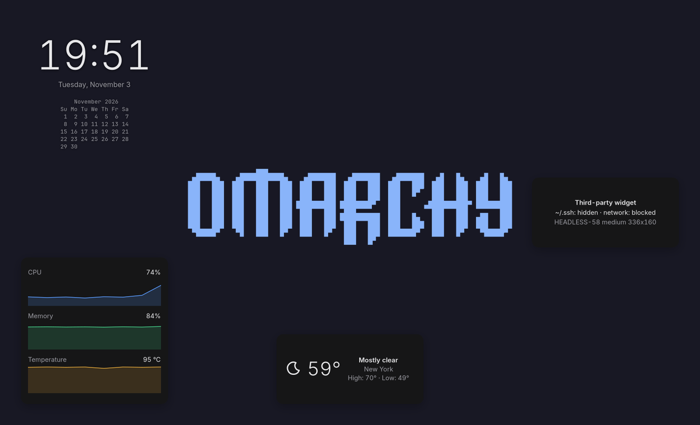
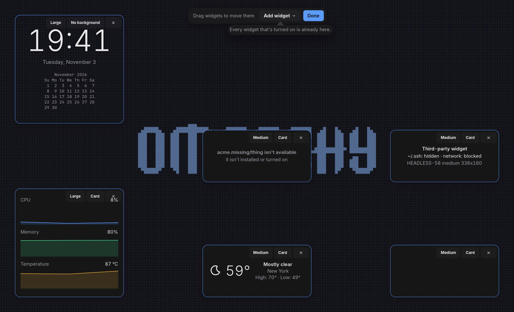

# Nyx Desktop Widgets

Widgets on the NyxOS desktop, behind windows, on every monitor. Every widget is a
`desktop` part of a [Nyx plugin](https://github.com/design-nexus/nyx-bar/blob/main/docs/plugins.md),
in any language, so adding one never needs a rebuild.



- Turn widgets on with `nyx plugin enable nyx.clock/large --kind desktop` (or `nyx
  plugin add` and `nyx plugin configure`); they appear top left on every monitor.
- Arrange them with `nyx-desktop-widgets --edit`: drag to move (they snap to an 8 px
  grid and keep to the nearest edge), change size and background, pin to the current
  workspace, remove, or add the ones that are turned on.
- Clicks pass through to the desktop, except on widgets that take them (the media
  player); those can open a popover on click and a menu on right click.
- Widgets come in compact, medium and large, grow with the suite's text scale, and
  some (the system graphs) can be dragged to any size.
- **Add widget** shows each widget live before it's placed.
- Widgets under windows or a fullscreen app, or on a locked screen, are paused: their
  plugins hear they can't be seen.
- Third-party widgets run sandboxed, with the same permissions and limits as in the
  bar.



## The layout

`~/.config/nyx/desktop-widgets.toml`, which `nyx plugin` and edit mode write and the
widgets follow as it changes:

```toml
version = 1

[[all.widget]]                       # on every monitor
part = "nyx.clock/large"
anchor = "top-left"                  # nine anchors: top-left, top, top-right, left, center, …
offset = [48, 48]                    # logical px from the anchor
size = "large"                       # compact, medium or large, as the part allows,
                                     # or "free" with width and height (resizable parts)
background = "none"                  # or "card" (the default)

[[monitor."LG Electronics|27GN950|012345".widget]]   # one monitor (or "DP-1")
part = "nyx.weather/card"
anchor = "top-right"
options = { units = "imperial" }     # passed to the plugin for this widget

[plugins."nyx.stats"]                # settings, as in bar.toml
every = 5
```

Widgets can belong to one workspace (its id or name), on every monitor or one:

```toml
[[all.workspace."3".widget]]          # only on workspace 3
part = "nyx.stats/graphs"
anchor = "center"
```

On that workspace it replaces the same part's widget for every workspace; edit mode's
pin moves a widget between the two. A monitor's own entry for a part replaces the
`all` one there. Styles go in
`~/.config/nyx/desktop-widgets.css`.

## Layout of the repo

| Path | What |
| --- | --- |
| `crates/nyx-desktop-widgets-core` | The layout file and the placement maths, without GTK |
| `apps/desktop-widgets` | The GTK host |
| `apps/desktop-widgets-backend` | The host without GTK, for the Quickshell interface: plugins, layout, placement, visibility, `DesktopWidgets1` |
| `qml/DesktopWidgets` | The Quickshell interface (a Nyx Shell component): the surfaces, edit mode, **Add widget** |
| `plugins/upnext` | Up next: the coming events from Nyx Calendar |
| `data/` | The user units: the GTK host, or the backend with Nyx Shell's `nyx-shell-qs` |
| `nix/` | The NyxOS package and how to wire it up |
| `docs/PLAN.md` | The plan, what's built and what isn't |

## D-Bus

`io.github.design_nexus.nyx.DesktopWidgets1` at `/io/github/design_nexus/nyx/DesktopWidgets`:
`Edit(b)`, `ListWidgets() → s` (JSON: plugins with their memory and CPU, and every
widget with its place and state), `Move(part, monitor, anchor, x, y)`,
`Resize(part, monitor, size)`, `Reload()`, `RestartPlugin(id)`.

## Trying it

`--only <output>` runs a separate test copy on one output that never takes the
keyboard, e.g. on a headless output:

```sh
cargo run -p nyx-desktop-widgets -- --only HEADLESS-2
```

The Quickshell interface the same way: a test backend for one output on its own
socket, and `qml/DesktopWidgets` loaded in `qs` with the Nyx QML modules (nyx-shell's
and nyx-design's `qml` folders on `QML_IMPORT_PATH`):

```sh
NYX_DW_ONLY=HEADLESS-2 NYX_DESKTOP_WIDGETS_UI_SOCKET=/tmp/dw.sock cargo run -p nyx-desktop-widgets-backend
NYX_DESKTOP_WIDGETS_UI_SOCKET=/tmp/dw.sock NYX_SHELL_SCREEN=HEADLESS-2 NYX_SHELL_NO_KEYBOARD=1 qs -p shell.qml
```

where `shell.qml` is `ShellRoot { DesktopWidgets.Main {} }` importing that folder. The
test copy owns `io.github.design_nexus.nyx.DesktopWidgets.Test` (so `Edit` and the
`Test…` methods reach it) and doesn't write the theme snapshot. Plugin CSS and `frame`
nodes aren't drawn by the Quickshell interface yet.

## License

MIT
